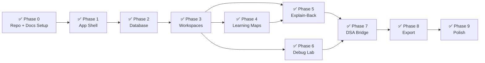
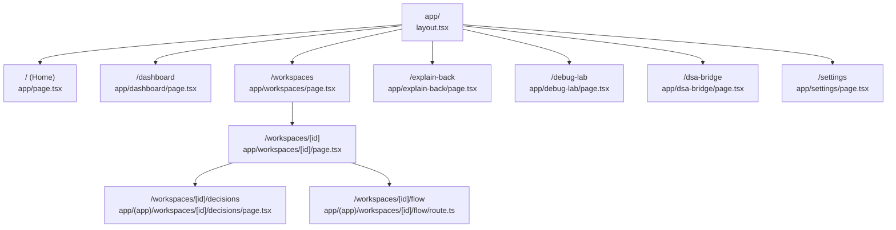
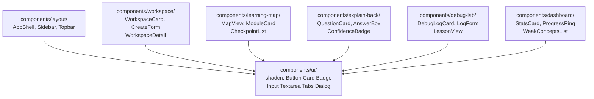
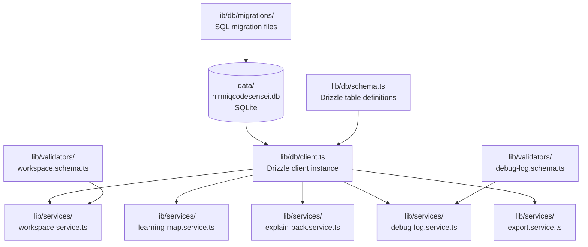
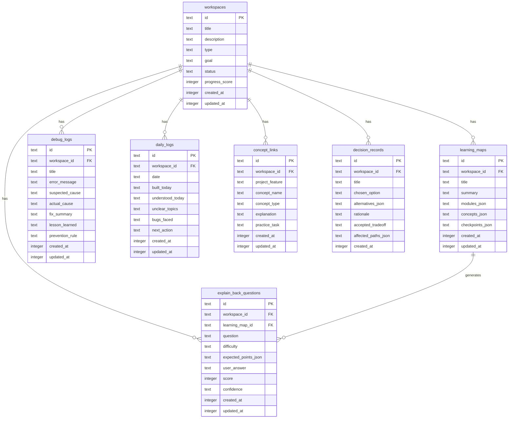

# Graphify Knowledge Graph — NirmiqCodeSensei

> This file is the living codebase map. Update it whenever a new file, module, or feature is added.
> AI tools should read this file INSTEAD of scanning the whole repo.
> Graphify MCP populates and queries this graph as code grows.

---

## How to Use This File

**Before coding:**
```
Read docs/GRAPHIFY_MAP.md.
Find the relevant node(s) for your task.
Read only those files. Do not load unrelated files.
```

**After coding:**
```
Update docs/GRAPHIFY_MAP.md with any new files or changed relationships.
```

For change rationale, use [`docs/decision.md`](decision.md). For real cross-file execution traces and the exact session change boundary, use [`docs/flow.md`](flow.md). Keep this map focused on stable file and module relationships.

---

## Phase Progress Graph



---

## App Route Graph



---

## Component Dependency Graph



---

## Service + Database Graph



---

## Database Schema Graph



---

## Feature → File Map (Quick Reference)

| Feature | Files to Read |
|---------|--------------|
| Workspace CRUD | `lib/services/workspace.service.ts`, `lib/db/schema.ts`, `app/workspaces/page.tsx`, `components/workspace/` |
| Learning Map | `lib/services/learning-map.service.ts`, `components/learning-map/`, `app/workspaces/[id]/page.tsx` |
| Explain-Back | `lib/services/explain-back.service.ts`, `components/explain-back/`, `app/explain-back/page.tsx` |
| Debug Lab | `lib/services/debug-log.service.ts`, `components/debug-lab/`, `app/debug-lab/page.tsx` |
| Dashboard | `components/dashboard/`, `app/dashboard/page.tsx` |
| Export | `lib/services/export.service.ts` |
| Decision Log | `lib/validators/decision.schema.ts`, `lib/services/decision.service.ts`, `mcp-server/index.ts`, `app/(app)/workspaces/[id]/decisions/` |
| Flow Markdown Export | `lib/services/export.service.ts`, `lib/services/learning-map.service.ts`, `app/(app)/workspaces/[id]/flow/route.ts` |
| Layout / Navigation | `components/layout/`, `app/layout.tsx` |
| DB Schema | `lib/db/schema.ts`, `lib/db/client.ts` |
| Development / TypeScript Config | `package.json`, `tsconfig.json`, `next.config.ts`, `instrumentation.ts` |
| Validation | `lib/validators/` |

---

## Current File Status

| File | Phase | Status |
|------|-------|--------|
| `app/page.tsx` | 0 | ✅ Done |
| `app/layout.tsx` | 0 | ✅ Done |
| `app/globals.css` | 0 | ✅ Done |
| `app/(app)/layout.tsx` | 1 | ✅ Done |
| `app/(app)/dashboard/page.tsx` | 1 | ✅ Done |
| `app/(app)/workspaces/page.tsx` | 1 | ✅ Done |
| `app/(app)/explain-back/page.tsx` | 1 | ✅ Done |
| `app/(app)/debug-lab/page.tsx` | 1 | ✅ Done |
| `app/(app)/dsa-bridge/page.tsx` | 1 | ✅ Done |
| `app/(app)/daily-log/page.tsx` | 1 | ✅ Done |
| `app/(app)/settings/page.tsx` | 1 | ✅ Done |
| `components/layout/AppShell.tsx` | 1 | ✅ Done |
| `components/layout/Sidebar.tsx` | 1 | ✅ Done |
| `components/layout/Topbar.tsx` | 1 | ✅ Done |
| `lib/db/schema.ts` | 2 | ✅ Done |
| `lib/db/client.ts` | 2 | ✅ Done |
| `lib/db/migrate.ts` | 2 | ✅ Done |
| `lib/db/migrations/` | 2 | ✅ Done |
| `lib/types.ts` | 2 | ✅ Done |
| `drizzle.config.ts` | 2 | ✅ Done |
| `instrumentation.ts` | 2 | ✅ Done |
| `lib/validators/workspace.schema.ts` | 3 | ✅ Done |
| `lib/services/workspace.service.ts` | 3 | ✅ Done |
| `app/(app)/workspaces/page.tsx` | 3 | ✅ Done |
| `app/(app)/workspaces/new/page.tsx` | 3 | ✅ Done |
| `app/(app)/workspaces/[id]/page.tsx` | 3 | ✅ Done |
| `app/(app)/workspaces/actions.ts` | 3 | ✅ Done |
| `components/workspace/WorkspaceCard.tsx` | 3 | ✅ Done |
| `components/workspace/CreateWorkspaceForm.tsx` | 3 | ✅ Done |
| `lib/validators/learning-map.schema.ts` | 4 | ✅ Done |
| `lib/services/learning-map.service.ts` | 4 | ✅ Done |
| `app/(app)/workspaces/[id]/learning-map/page.tsx` | 4 | ✅ Done |
| `app/(app)/workspaces/[id]/learning-map/actions.ts` | 4 | ✅ Done |
| `components/learning-map/CreateMapForm.tsx` | 4 | ✅ Done |
| `components/learning-map/AddModuleForm.tsx` | 4 | ✅ Done |
| `components/learning-map/ModuleCard.tsx` | 4 | ✅ Done |
| `components/learning-map/AddCheckpointForm.tsx` | 4 | ✅ Done |
| `lib/utils.ts` | 5 | ✅ Done |
| `lib/validators/explain-back.schema.ts` | 5 | ✅ Done |
| `lib/services/explain-back.service.ts` | 5 | ✅ Done |
| `app/(app)/workspaces/[id]/explain-back/page.tsx` | 5 | ✅ Done |
| `app/(app)/workspaces/[id]/explain-back/actions.ts` | 5 | ✅ Done |
| `app/(app)/explain-back/page.tsx` | 5 | ✅ Done |
| `components/explain-back/QuestionCard.tsx` | 5 | ✅ Done |
| `components/explain-back/AddQuestionForm.tsx` | 5 | ✅ Done |
| `lib/validators/debug-log.schema.ts` | 6 | ✅ Done |
| `lib/services/debug-log.service.ts` | 6 | ✅ Done |
| `app/(app)/workspaces/[id]/debug-lab/actions.ts` | 6 | ✅ Done |
| `app/(app)/workspaces/[id]/debug-lab/page.tsx` | 6 | ✅ Done |
| `components/debug-lab/CreateDebugLogForm.tsx` | 6 | ✅ Done |
| `components/debug-lab/DebugLogCard.tsx` | 6 | ✅ Done |
| `lib/validators/concept-link.schema.ts` | 7 | ✅ Done |
| `lib/services/concept-link.service.ts` | 7 | ✅ Done |
| `app/(app)/workspaces/[id]/dsa-bridge/actions.ts` | 7 | ✅ Done |
| `app/(app)/workspaces/[id]/dsa-bridge/page.tsx` | 7 | ✅ Done |
| `components/dsa-bridge/AddConceptLinkForm.tsx` | 7 | ✅ Done |
| `components/dsa-bridge/ConceptLinkCard.tsx` | 7 | ✅ Done |
| `lib/services/export.service.ts` | 8 | ✅ Done |
| `app/(app)/workspaces/[id]/export/route.ts` | 8 | ✅ Done |
| `lib/validators/daily-log.schema.ts` | 9 | ✅ Done |
| `lib/services/daily-log.service.ts` | 9 | ✅ Done |
| `app/(app)/workspaces/[id]/daily-log/actions.ts` | 9 | ✅ Done |
| `app/(app)/workspaces/[id]/daily-log/page.tsx` | 9 | ✅ Done |
| `components/daily-log/CreateDailyLogForm.tsx` | 9 | ✅ Done |
| `components/daily-log/DailyLogEntry.tsx` | 9 | ✅ Done |
| `app/(app)/daily-log/page.tsx` | 9 | ✅ Done |
| `app/(app)/dashboard/page.tsx` | 9 | ✅ Done |
| `lib/validators/decision.schema.ts` | 10 | ✅ Done |
| `lib/services/decision.service.ts` | 10 | ✅ Done |
| `app/(app)/workspaces/[id]/decisions/page.tsx` | 10 | ✅ Done |
| `app/(app)/workspaces/[id]/decisions/export/route.ts` | 10 | ✅ Done |
| `app/(app)/workspaces/[id]/flow/route.ts` | 10 | ✅ Done |
| `lib/db/migrations/0012_complete_marauders.sql` | 10 | ✅ Done |

> Update this table after completing each file.


## Guided pathway implementation (2026-10-28)

| Capability | Files |
|---|---|
| Evidence/identity contracts and legacy normalization | lib/pathways/shared.ts, snapshot.ts |
| Bounded static calls and local alias configuration | lib/pathways/static-calls.ts |
| Snapshot/freshness and confined source | lib/services/pathway.service.ts, source-view.service.ts |
| Immutable review/attempt persistence | lib/services/pathway-learning.service.ts |
| Study catalog, user prerequisites and cycle checks | lib/services/study-path.service.ts |
| Canonical guided UI and history | components/learning-map/LearningMapExperience.tsx, components/explain-back/PathwayAttemptHistory.tsx |
| Source / learning APIs | app/(app)/workspaces/[id]/source/route.ts, pathway/route.ts |
| Durable schema | pathway_reviews, pathway_attempts, study_nodes, study_edges; migration 0013 |
| Behavioral/security/refresh fixtures | tests/pathways.test.mts |

Learning Map page → pathway snapshot/freshness → guided UI → confined source or learner-record APIs. Analysis → snapshot builder → bounded compiler → transactional map swap. Legacy Feature Trace redirects to Learning Map. See LEARNING_MAP_MASTER_PLAN.md for rollout status.
